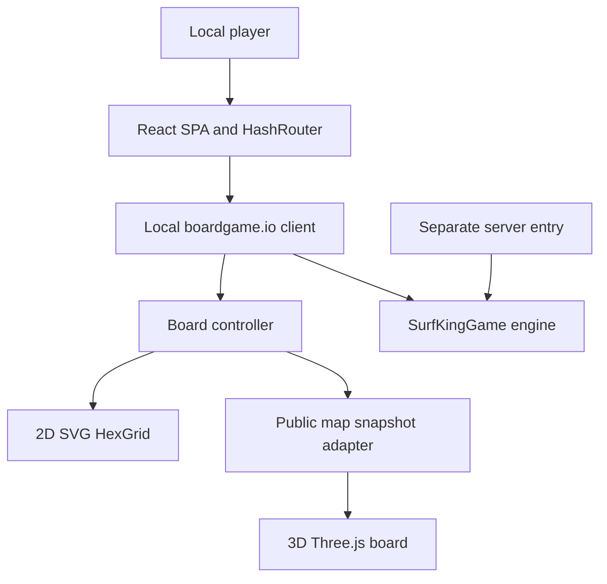
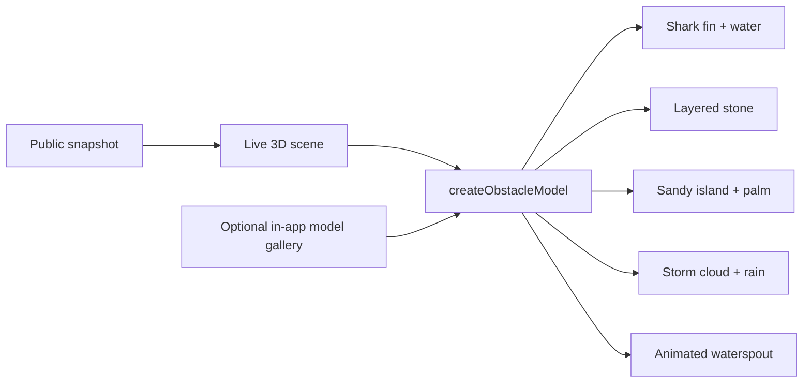
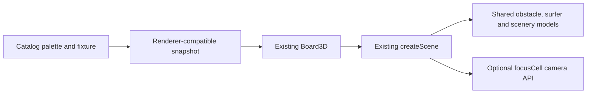
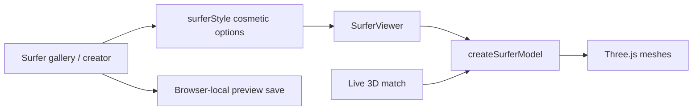
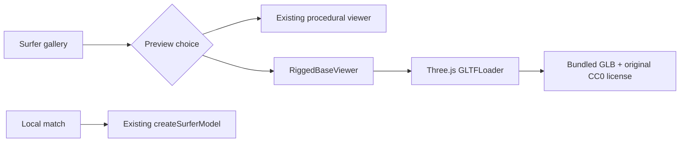
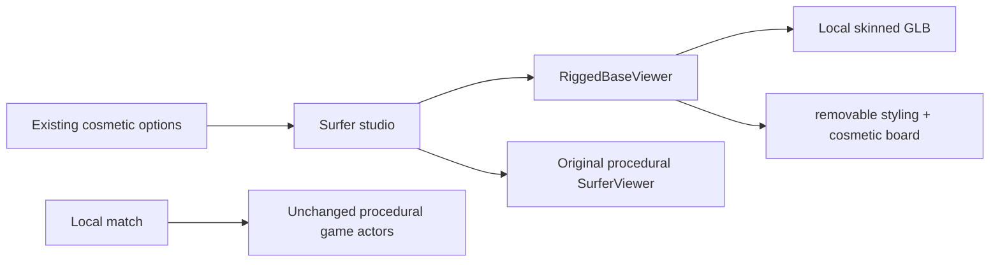
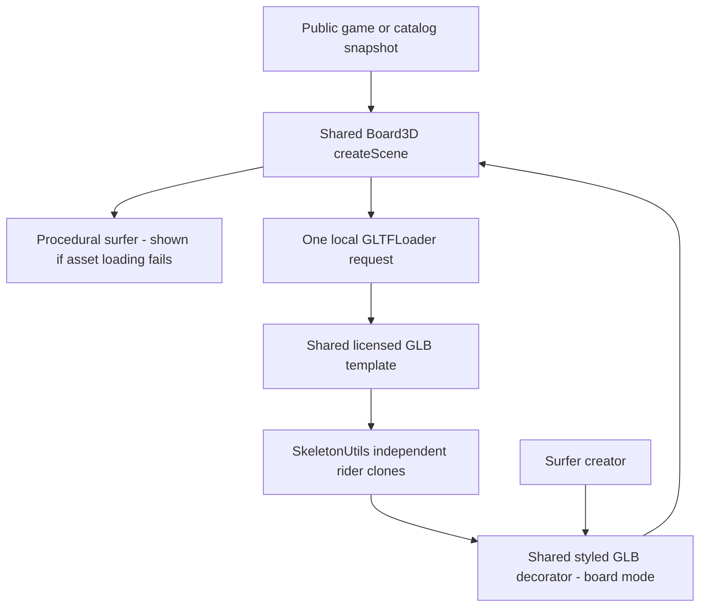
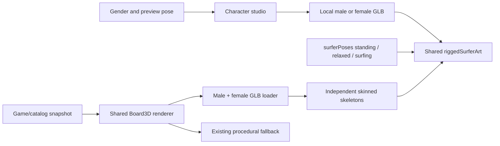
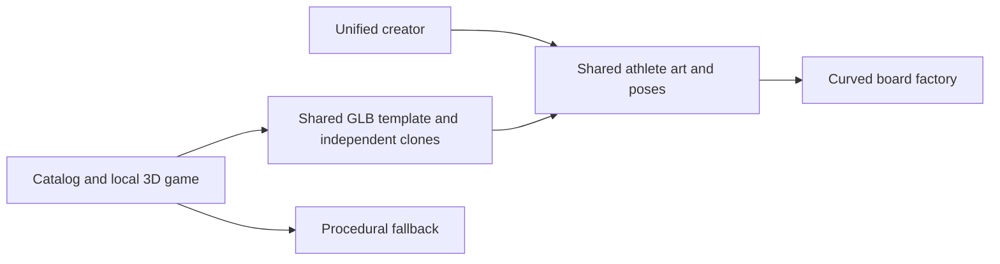
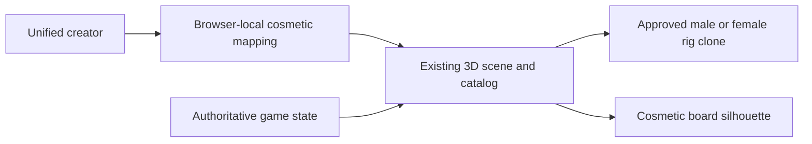

# Architecture

**Reference main baseline before PR #14:** `6daa1705` (2026-11-15). Deployment status is not established by merge state.

## Existing browser architecture (C4-style L2)

- The local game client and standalone server entry do not establish live online multiplayer.
- `src/components/Board/Board.js` owns UI actions, the selected 2D/3D view, and card handling.
- `src/map/contract/createPublicMapSnapshot.js` exposes cell/obstacle positions, players and turn metadata to rendering, not private card/deck data.
- Both 2D and 3D share `src/map/layout/board-layout.json` (53 cells); authoritative geometry remains provisional.
- `src/map/views/Board3D/createScene.js` controls camera, cell raycast, scene updates, animation, cleanup and live obstacle groups.
- Gameplay rules and scoring remain inside `src/game/SurfKingGame.js`, not Three.js.

## 3D obstacle model component (PR #14, L3)

- `obstacleModels.js` builds Three.js meshes for the five existing obstacle identifiers; `sharkModel.js` remains the dedicated dorsal-fin component.
- `createScene.js` instantiates the same factory from the authoritative public snapshot; no mock placements or image sprites are used in a match.
- The `/obstacles` route previews exactly these factories in a separate WebGL scene without modifying game state.
- Player models and coastal scenery continue using the existing `surfModels.js` and `createCoastalScenery.js` code.

## Interactive 3D board catalog (Issue #15, merged PR #16)

The standalone `/#/catalog` route uses the existing `Board3D` component rather than an independent renderer. A pure `catalogState.js` fixture creates 53 cells, model placements, surfer positions and a public snapshot matching the renderer contract. Its click tools operate only on local React state, not the real `boardgame.io` match.

This is a visual design sandbox with illustrative placements, not an alternate rules engine or authoritative gameplay state. PR #16 is merged into `main`; real browser validation is still pending. Merge does not establish deployment.

## Current obstacle visual refinement (Issue #13, in review)

`obstacleModels.js` keeps a single model factory for match, gallery and catalog. Stone and Island procedural meshes match the silhouettes/palette of the repository card images; Shark, Storm and Cyclone use foam/wakes directly above the scene ocean without opaque blue water cylinders. Storm flashes select among prebuilt branched lightning geometries; Cyclone and Shark use bounded deterministic multi-frequency motion. No per-frame meshes are allocated. All visual effects remain outside the game-state and rule engine.

## Surfer gallery and cosmetic creator (Issue #20, draft PR #21)

The existing `createSurferModel()` procedural Three.js model now accepts optional normalized cosmetic choices while preserving its original six-argument game rendering contract. The same constructor is used in live play and `SurferViewer`; no gameplay state enters the studio.

- `/#/surfers` selects four sample outfits and boards using a reusable WebGL preview.
- `/#/customize` adjusts presentation, hairstyle, hair/skin/surfwear colors, board silhouette and board color; changes rebuild actual geometry. `surferStyle.js` validates options.
- The preview uses shared scene primitives with OrbitControls. The UI contains CSS-drawn tropical scenery and an **approximation** of the approved wooden/crown logo rather than the exact screenshot asset.
- `Guardar visual` stores a versioned cosmetic object in the current browser's localStorage. **Selections are not associated with a player ID or match snapshot yet**, and have no gameplay effects.
- WebGL, mobile presentation, live-game style transfer and production build remain unverified.

## Isolated rigged GLB character evaluation (Issue #22)

The existing `/#/surfers` studio gallery has an opt-in compare control between the merged procedural `SurferViewer` and a separate `RiggedBaseViewer`. The new component lazy-loads Three.js `GLTFLoader` and reads `/assets/surfers/quaternius-male-base.glb` **from this repository**, fitting the imported skinned mesh to a studio frame. At the time of PR #23 this was a gallery-only experiment; PR #25 added the studio style, and Issue #26 now brings that shared style to `createScene.js`. The game rules and public map snapshot remain unchanged.

The GLB candidate is a static neutral base with rigging, **not a final animated or customizable surfer**. Browser/WebGL validation and art review are pending. Rollback is simple: remove the gallery comparison and asset without affecting local matches.

## Styled GLB studio preview (Issue #24, merged PR #25)

`riggedSurferArt.js` adds cosmetic materials and removable accessory meshes around the **existing skinned** Quaternius GLB. It retains the imported skeleton and humanoid geometry; changing a style replaces temporary materials/accessories, not the asset or game state. `RiggedBaseViewer` caches one loaded GLB and supports a styled view and untouched base view. The studio `/#/customize` now defaults to the styled GLB with an explicit procedural fallback; the gallery offers all three modes.

The imported body is male-only. No final female GLB, retargeted surfing animation or player-profile persistence exists. Issue #26 adds the same styled preview to board actors without connecting saved player profiles. This preview does not affect game rules or board-identity colors. Real WebGL validation remains pending.
## Shared 3D board GLB surfers (Issue #26, merged PR #27)

The existing `createScene.js` public-snapshot renderer now uses the same styled GLB art as the studio. `riggedSurferArt.js` is located in `src/map/views/Board3D/` and is shared by `RiggedBaseViewer` and the board. For board mode, the cosmetic board sits flat under the rider's feet, the figure has a side-on stance, and the whole actor is scaled to an ordinary 53-cell hex.

`riggedBoardSurfers.js` loads the **local** CC0 GLB once per scene, then uses `SkeletonUtils.clone` to give every active surfer independent bones; source geometry stays shared. Seven established player colors are preserved on the boards, while the rider's hair/outfit use the existing preset styles. These presets are previews, **not** saved player profiles or gameplay attributes.

On successful loading, clones attach to the **existing actor groups**, retaining cell movement, camera focus and object identity. The procedural meshes remain hidden during loading and are shown as fallback if loading, validation or styling fails. Async completion checks scene disposal; individual actor removal destroys only owned accessory geometry/materials and the independent procedural geometry, **never shared source GLB geometry or pooled materials**. No changes to rules, movement, player snapshots, obstacles or the 2D renderer.

**Pending:** Jest/build/WebGL/mobile checks, final surf stance review, genuine female rig, performance measurement. The GLB preview is not a full player-customization-to-match integration.
## Distinct gender models and stance controller (Issue #28, unmerged)

The character studio and shared `Board3D` renderer retain the same skinned-model pipeline but now select **different locally bundled Quaternius male and female assets**. `riggedBoardSurfers.js` loads one GLB of each gender per scene, upgrades eligible actor groups after each load, and independently clones each rig with `SkeletonUtils.clone`. Missing/invalid models continue to use the existing procedural fallback for that character, without altering other players or game state.

`RiggedBaseViewer` loads the selected gender asset, remounting on gender changes to ignore stale asynchronous callbacks. `surferPoses.js` supplies pure, deterministic bone-offset samples for **standing**, **relaxed** and **surfing** poses. `riggedSurferArt.js` applies offsets relative to each asset's bind-pose quaternions, keeping the underlying skinned body and facial geometry; disposal restores the original skeleton. The studio pose selector is local preview state, **not saved with a cosmetic profile**. Board riders always use the surfing preset.

The female GLB is separately authored from the same CC0 pack; source and texture-free packaging are documented in `DATA_SOURCES.md`. This is **not** a validated motion-capture animation set, final facial-expression system or gameplay ability mechanic. Browser/WebGL bone-axis and foot-to-board alignment remain pending.
## Selected athlete integration (Issue #33, merged PR #36)

`/#/customize` is the single visible surfer creator; older gallery and review URLs redirect to it. It loads the unchanged textured Female Athlete GLB by default and uses `athleteSurferArt.js` for standing, relaxed and surfing poses and the curved board factory from PR #35. The approved male GLB is acquired before startup/build/test by a local preparation script that checks exact size/hash, then both characters are selectable from the same local asset registry. The creator persists gender in the existing browser-local style and sends the selected character and board type to the catalog. Relaxed poses share a bounded right-forearm wave with reduced-motion support. Geometry and textures are preserved. Board shape and paint are cosmetic, and the saved browser style is not a player profile.

The catalog can receive the selected board shape from the creator; game board colors still identify players. The local 3D board uses both approved models for the corresponding presets, retaining procedural fallback. No changes to match rules or public snapshot schema. Hair, skin and clothing are baked into the current texture/mesh and are not yet independent customization options. The owner accepted the integrated baseline; see HANDOFF.md for successful tests, desktop WebGL and deferred release QA.

## Snapshot-driven board motion (Issue #37, merged PR #38)

The shared 3D scene uses a presentation-only sampler in `surferMotion.js` to interpolate authoritative cell changes with smooth acceleration/deceleration and a bounded S-shaped lateral offset. Idle carving is centered on each cell and blended with travel; tangent yaw and longitudinal board bank are visual only. The snapshot projects the engine's existing `fellOffTheBoard` marker to a public boolean. Each actor tracks a retargetable fall progress. Shared athlete art interpolates precomputed local skeletal poses: alternating weight transfer during carving and staged loss of balance on a fixed rider pivot during falls. Hip shifts use leg IK to retain original ankle positions at keyframes. The initial board rocks and anchored stumble transition into chest-level water immersion and an independently pitched board beside the rider. The ocean height sampler mirrors the existing vertex shader; the actual opaque ocean hides geometry below its surface. Small visual offsets are applied only within the logical cell. Full water recovery selects a separate remount timeline, with independent board flattening, a curved near-rail approach, shoulder-derived local yaw to face the board before support, rider elevation, alternating lifted-leg targets and a crouch-to-riding sequence. The local yaw fades back to the approved surf stance; the fall pose is unchanged. A bounded two-bone arm IK correction targets the moving near-side deck during the press phase, then releases. Physical grip, exact hand/foot contact and buoyancy are not simulated. Reduced motion resolves directly to target. The catalog supplies isolated preview state through the same snapshot contract, with controls for both riders. No game logic, private cards or legal move calculations are added to the renderer.

## R1 local playtest branch (#42)

The local setup offers the experimental `SurfKingR1` alongside the original `SurfKingGame`. R1 keeps authoritative deck, turn, energy, fall, targeting, and winner logic in `src/game/r1/SurfKingR1.js`, with adjacency derived from the existing layout manifest. The boardgame.io random plugin owns all gameplay randomness, including the one-time full player-order shuffle. Each round repeats that order. Island is persistent terrain, with its energy effect handled only on ordinary entry. The shared Board selects R1 controls and publishes R1 legal destinations plus a presentation-only targetHighlight descriptor (kind, cellIds, preview). Both renderers use a common palette from the map contract. The target descriptor optionally includes blocked opponent IDs and reason codes from read-only engine diagnostics; SVG and pooled WebGL icons distinguish protection, minimum energy and other restrictions. Legal targets and action dispatch remain separate from inspection. Self-card and Surf Current first-step previews never enable extra actions. The 2D grid draws inset transparent polygons without intercepting clicks; the 3D scene maintains a full-board overlay pool with shared geometry and materials. Movement previews query the engine using a hypothetical maneuver phase without changing state or click eligibility. 2D and 3D remain views of a single state. Legacy moves and card assets are unchanged. R1 controls derive the visible round order from the authoritative once-shuffled match order and completed-turn count. The floating HUD (`R1Controls.js`, `R1Hud.css`) uses the shared lightweight player identity palette, energy meters, original card art and a collapsible bottom card dock with contextual details. The map occupies a single full-viewport grid row; the HUD is absolutely positioned with pointer input only on its interactive islands, so changing hand/selection content cannot resize the canvas. Card confirmation and inspection are presentation state; the same engine queries and move handlers remain authoritative. The lightweight r1CardFeedback helper derives availability, reason, next action and preview IDs from current engine eligibility. Board scopes hover/focus preview by player and round and publishes it through the existing shared highlight descriptor, while actual target clicks use only the committed selection; committed actions and maneuver phases take precedence. Hex inspection uses the shared r1HexFeedback helper, authoritative legal target queries and public terrain/occupant data. SVG hover events and the existing 3D raycast emit cell IDs; Board owns hover and phase-scoped invalid-click inspection, and the HUD displays nonblocking contextual feedback without changing the action dispatcher or scene lifetime. Shared r1FeedbackVisuals components reuse card/terrain art and SVG pictograms for compact range, energy, hazard and action labels; full descriptions remain accessible. Card inspection, action context and hand share one adaptive vertical scroll region. Panels use intrinsic content height; the entire dock is bounded by the actual match height and safe-area margins. The primary action bar remains outside the inner scroll region and the dock itself provides fallback overflow. Horizontal lists retain automatic overflow. The underlying map keeps its fixed viewport. The hex island mounts only for hover or a pinned hex; dismissing the pin clears the 3D selection ring. Match event messages and dice results are separate. Direct attack cards cap damage at target energy minus one and never invoke the fall/card-transfer path; the engine excludes one-energy targets from card targeting but retains them for Drop In. Terrain-entry falls remain possible. The attack controls share the engine's range and eligibility checks; Drop In uses two graph edges, can repeat without initiation cost while energy is at least two; the engine validates the selected dice count against the two-die cap and energy minus one, compares descending matched pairs, and applies both energy losses. The UI shows the pair results. A lethal Drop In stores a single pending swap decision and blocks other moves until resolved. Keeping position restores the previous phase; exchanging occupancy atomically consumes the movement allowance, resolves attacker terrain entry, and either ends the turn or permits the unused non-movement card allowance in a dedicated phase. Nonlethal Drop In preserves the pre-movement phase (including a pending card), and card receipt overflow is discarded automatically using game RNG; blocked actions display the reason, and selected opponent cells use the existing legal-target highlights and named buttons. The public snapshot exposes the R1 active-turn marker ID (null on game over); the 3D scene owns a single rotating surfboard-shaped marker that follows the active actor. The 2D board shows the same current-player marker. Initial test/build CI passed; the follow-up visual checks and updated CI remain pending. No online rollout is authorized.

## R1 shared-hex trial (SK-DEC-044)

R1 occupancy is derived exclusively from player cellPosition, not the legacy single cell.player field. Movement queries enforce capacity two; obstacle placement requires zero occupants. Attack and Change queries return individual player IDs plus deduplicated cell IDs for highlights. Action handlers accept an explicit target player ID and reject ambiguous cell-only requests; the controller offers named target buttons and pins ambiguous hex inspection instead of acting. The public snapshot already supports multiple players in the same cell. SVG renders separate colored number markers, and Three.js spaces shared actors and uses player-colored markers for individual targeting without changing logical cell IDs. Both renderers retain the shared legal-cell highlight descriptor and blocked reason codes. Hang Loose and Amulet are separate active-card types; their expiry uses existing begin-turn discard. Legacy rules are unchanged.

## Browser-local athlete appearance mapping (Issue #40)

`localSurferProfiles.js` stores only a validated `{character, boardType}` mapping for local player IDs 0–6, plus the last edited player. The unified creator continues to store its older global preview draft for compatibility. At 3D scene creation, the existing board pipeline resolves a player's saved appearance before choosing the independent approved male/female skinned clone and board silhouette. The seven player board colors remain fixed; no saved profile enters the public snapshot or game engine. Changes become visible when the 3D scene remounts. Missing/invalid storage preserves existing presets. Appearance beyond character and board shape requires separately authored materials and is not provided here.

## Limits and validation

- Static concept illustrations guided the visual direction but are **not exact exported 3D models**.
- One existing licensed local Quaternius GLB is reused in the scene; no new external runtime services or assets are required for Issue #26.
- Jest, strict build and desktop WebGL checks passed for PR #38; mobile and production-performance review remains deferred in #33. See [HANDOFF.md](HANDOFF.md).
- No changes to authoritative turn logic, 2D fallback, backend architecture or hosting.

## R1 card artwork (Issue #44)
`r1CardArt.js` maps current R1 card names to locally bundled WebP art and presentation-only functional colors; terrain inspection reuses matching card art plus Shark. `R1Controls` renders live names and short effects, `r1FeedbackVisuals` retains effect/range SVG icons, and `R1Hud.css` owns the frame and visual state. No rule data or text is baked into the artwork. Legacy art, board geometry, selection, targeting and layout dimensions remain unchanged. The common back is bundled but not used by a new control.

R1 first-arrival victory (#48): the engine sets the winner before advancing the turn order; the public map snapshot optionally exposes the winner ID. Individual restriction labels use the shared map palette, replacing ambiguous per-cell glyphs when an opponent is identified. The HUD and both map views identify the winner without changing target eligibility.

Shared-hex inspection (#48, SK-DEC-047) retains terrain and all public occupants in one read-only HUD model, with independent state and target diagnostics per occupant. The selected-card descriptor includes individual legal player IDs. Both views reuse the same inspection panel; no private hands are projected into it and existing action dispatch is unchanged.

## Local R1 presentation events and card raft (#50 / #42)

The local review branch projects public card-play events and active defenses from the R1 match into the shared 3D scene. The event records the acting player, targets and actual energy delta; it is presentation data and does not change move validation or damage. The 3D scene uses it to play the existing card effects and animate a discarded card to the raft. The raft and its card piles are scene objects; the 2D view retains screen-space piles. Active protections remain sourced from the authoritative player state. This integration is unmerged and requires manual match and mobile visual validation.

The local R1 terrain feedback event also reports the actual Island energy gain, including zero at the energy cap. The HUD presents the gain or full-energy state, and the 3D board uses the existing energy effect after arrival when energy increases. Jumping does not publish an Island entry event.
