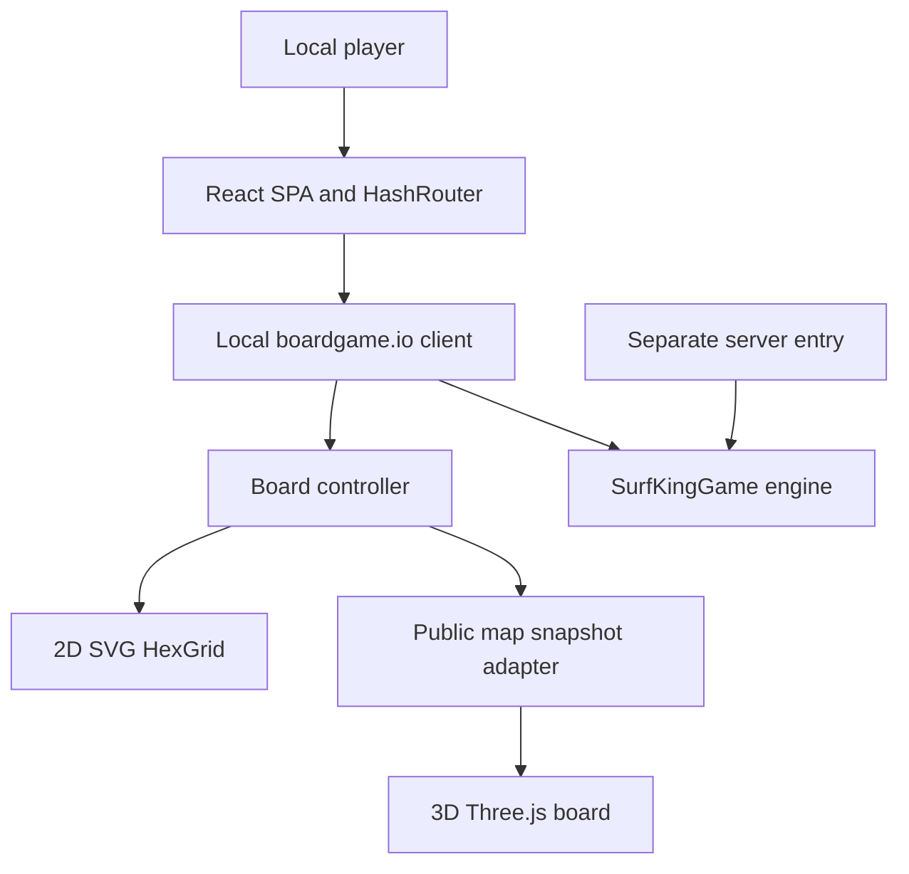
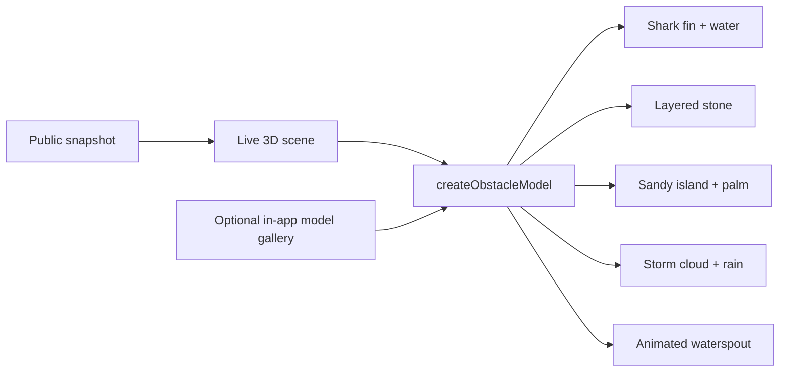
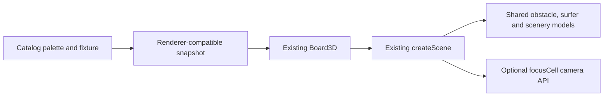
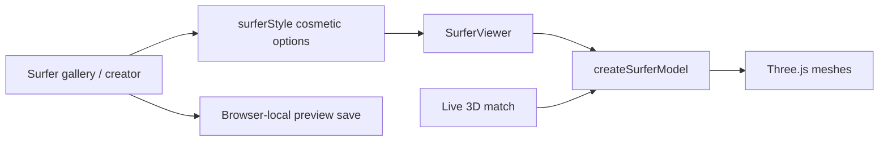
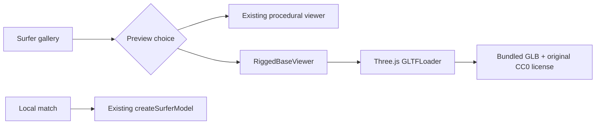
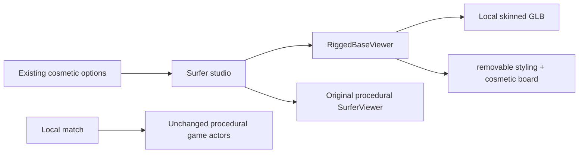
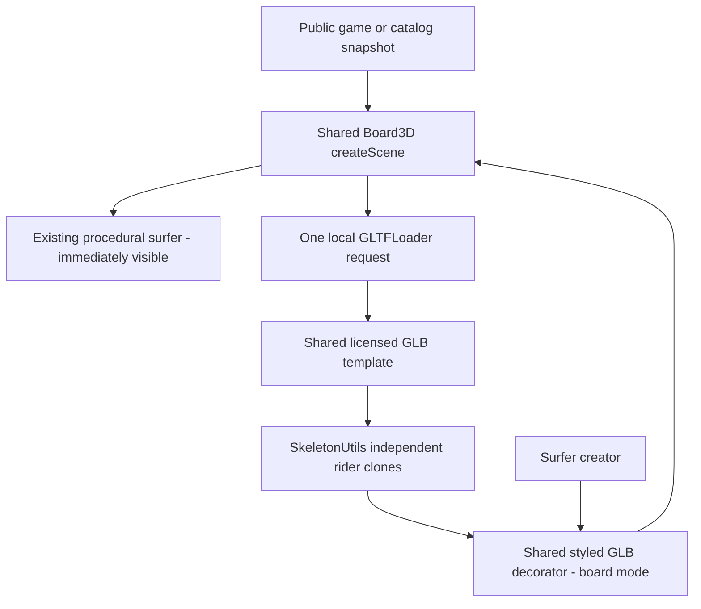

# Architecture

**Reference main baseline before PR #14:** `6daa1705` (2026-11-15). Deployment status is not established by merge state.

## Existing browser architecture (C4-style L2)

- The local game client and standalone server entry do not establish live online multiplayer.
- `src/components/Board/Board.js` owns UI actions, the selected 2D/3D view, and card handling.
- `src/map/contract/createPublicMapSnapshot.js` exposes cell/obstacle positions, players and turn metadata to rendering, not private card/deck data.
- Both 2D and 3D share `src/map/layout/board-layout.json` (53 cells); authoritative geometry remains provisional.
- `src/map/views/Board3D/createScene.js` controls camera, cell raycast, scene updates, animation, cleanup and live obstacle groups.
- Gameplay rules and scoring remain inside `src/game/SurfKingGame.js`, not Three.js.

## 3D obstacle model component (PR #14, L3)

- `obstacleModels.js` builds Three.js meshes for the five existing obstacle identifiers; `sharkModel.js` remains the dedicated dorsal-fin component.
- `createScene.js` instantiates the same factory from the authoritative public snapshot; no mock placements or image sprites are used in a match.
- The `/obstacles` route previews exactly these factories in a separate WebGL scene without modifying game state.
- Player models and coastal scenery continue using the existing `surfModels.js` and `createCoastalScenery.js` code.

## Interactive 3D board catalog (Issue #15, merged PR #16)

The standalone `/#/catalog` route uses the existing `Board3D` component rather than an independent renderer. A pure `catalogState.js` fixture creates 53 cells, model placements, surfer positions and a public snapshot matching the renderer contract. Its click tools operate only on local React state, not the real `boardgame.io` match.

This is a visual design sandbox with illustrative placements, not an alternate rules engine or authoritative gameplay state. PR #16 is merged into `main`; real browser validation is still pending. Merge does not establish deployment.

## Current obstacle visual refinement (Issue #13, in review)

`obstacleModels.js` keeps a single model factory for match, gallery and catalog. Stone and Island procedural meshes match the silhouettes/palette of the repository card images; Shark, Storm and Cyclone use foam/wakes directly above the scene ocean without opaque blue water cylinders. Storm flashes select among prebuilt branched lightning geometries; Cyclone and Shark use bounded deterministic multi-frequency motion. No per-frame meshes are allocated. All visual effects remain outside the game-state and rule engine.

## Surfer gallery and cosmetic creator (Issue #20, draft PR #21)

The existing `createSurferModel()` procedural Three.js model now accepts optional normalized cosmetic choices while preserving its original six-argument game rendering contract. The same constructor is used in live play and `SurferViewer`; no gameplay state enters the studio.

- `/#/surfers` selects four sample outfits and boards using a reusable WebGL preview.
- `/#/customize` adjusts presentation, hairstyle, hair/skin/surfwear colors, board silhouette and board color; changes rebuild actual geometry. `surferStyle.js` validates options.
- The preview uses shared scene primitives with OrbitControls. The UI contains CSS-drawn tropical scenery and an **approximation** of the approved wooden/crown logo rather than the exact screenshot asset.
- `Guardar visual` stores a versioned cosmetic object in the current browser's localStorage. **Selections are not associated with a player ID or match snapshot yet**, and have no gameplay effects.
- WebGL, mobile presentation, live-game style transfer and production build remain unverified.

## Isolated rigged GLB character evaluation (Issue #22)

The existing `/#/surfers` studio gallery has an opt-in compare control between the merged procedural `SurferViewer` and a separate `RiggedBaseViewer`. The new component lazy-loads Three.js `GLTFLoader` and reads `/assets/surfers/quaternius-male-base.glb` **from this repository**, fitting the imported skinned mesh to a studio frame. At the time of PR #23 this was a gallery-only experiment; PR #25 added the studio style, and Issue #26 now brings that shared style to `createScene.js`. The game rules and public map snapshot remain unchanged.

The GLB candidate is a static neutral base with rigging, **not a final animated or customizable surfer**. Browser/WebGL validation and art review are pending. Rollback is simple: remove the gallery comparison and asset without affecting local matches.

## Styled GLB studio preview (Issue #24, merged PR #25)

`riggedSurferArt.js` adds cosmetic materials and removable accessory meshes around the **existing skinned** Quaternius GLB. It retains the imported skeleton and humanoid geometry; changing a style replaces temporary materials/accessories, not the asset or game state. `RiggedBaseViewer` caches one loaded GLB and supports a styled view and untouched base view. The studio `/#/customize` now defaults to the styled GLB with an explicit procedural fallback; the gallery offers all three modes.

The imported body is male-only. No final female GLB, retargeted surfing animation or player-profile persistence exists. Issue #26 adds the same styled preview to board actors without connecting saved player profiles. This preview does not affect game rules or board-identity colors. Real WebGL validation remains pending.
## Shared 3D board GLB surfers (Issue #26, draft)

The existing `createScene.js` public-snapshot renderer now uses the same styled GLB art as the studio. `riggedSurferArt.js` is located in `src/map/views/Board3D/` and is shared by `RiggedBaseViewer` and the board. For board mode, the cosmetic board sits flat under the rider's feet, the figure has a side-on stance, and the whole actor is scaled to an ordinary 53-cell hex.

`riggedBoardSurfers.js` loads the **local** CC0 GLB once per scene, then uses `SkeletonUtils.clone` to give every active surfer independent bones; source geometry stays shared. Seven established player colors are preserved on the boards, while the rider's hair/outfit use the existing preset styles. These presets are previews, **not** saved player profiles or gameplay attributes.

On successful loading, clones attach to the **existing actor groups**, retaining cell movement, camera focus and object identity. The procedural meshes are hidden but remain as fallback; if loading/validation fails, gameplay continues with the old models. Async completion checks scene disposal; individual actor removal destroys only owned accessory geometry/materials and the independent procedural geometry, **never shared source GLB geometry or pooled materials**. No changes to rules, movement, player snapshots, obstacles or the 2D renderer.

**Pending:** Jest/build/WebGL/mobile checks, final surf stance review, genuine female rig, performance measurement. The GLB preview is not a full player-customization-to-match integration.
## Limits and validation

- Static concept illustrations guided the visual direction but are **not exact exported 3D models**.
- One existing licensed local Quaternius GLB is reused in the scene; no new external runtime services or assets are required for Issue #26.
- Full browser, WebGL, Jest and build validation remain pending; see [HANDOFF.md](HANDOFF.md).
- No changes to authoritative turn logic, 2D fallback, backend architecture or hosting.
