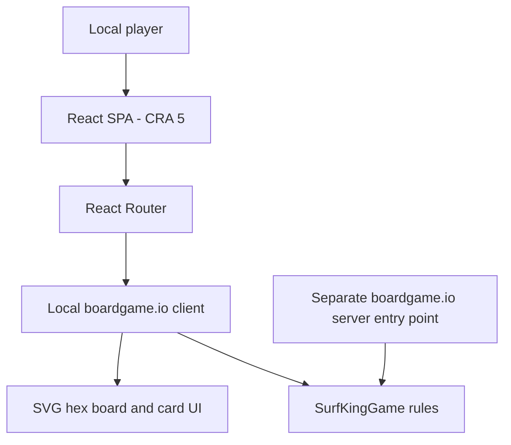
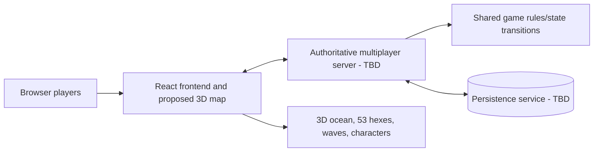

# Architecture

**Verified code baseline:** `main` at `76f1a673219cbc8be28fd97dc76c1ecabf3394f3`, inspected 2026-11-14. This is not evidence of running production services.

## Existing structure (C4-style container view, L2)

The local client does not connect to the server in the inspected source. The home page contains links for online and AI play, but their routes in `src/Routes.js` are disabled.

## Existing components (L3 code boundaries)

| Component | Location | State |
| --- | --- | --- |
| Routing | `src/Routes.js` | Home/local routes enabled |
| Local client | `src/pages/LocalPage/index.js` | Instantiates `boardgame.io/react` client |
| Game rules | `src/game/SurfKingGame.js`, `Board.js`, `Cards.js` | State, move, card and turn logic implemented, untested in recovery |
| Board UI | `src/components/Board/`, `HexGrid/`, `Hex/` | SVG hexagons, clicks, card interactions |
| Server | `src/server/index.js` | Standalone `boardgame.io` server and lobby configuration |
| Tests | `src/game/__tests__/`, `src/App.test.js` | 21 files present; results unknown |

## Current contracts

- Game state (`G`) includes `cells`, `players`, `deck`, `discardedCards`, `turn` and `currentMove`.
- `boardgame.io` context (`ctx`) and moves include `maneuver`, `dropIn`, `useCard`, and `pass`.
- Logical positions are indices 0 through 52 (`GRID_SIZE = 53`). The grid UI currently creates 56 placeholder elements, and its cell mapping needs validation.
- The current rules engine is coupled to `boardgame.io` APIs.

## Target concept — proposed, not implemented (L2)

Options being investigated: Three.js/React Three Fiber, continued `boardgame.io` or Nakama, and Vercel/Render/Supabase. Selection and integration are not established by this diagram.

## Risks

- Dependency age, Node 16.17 Docker base, and `loadsh` versus `lodash` import discrepancy.
- Cell indexing and rendering contract not yet reconciled for the 3D scene.
- Authentication, persistence, server authority, reconnect behavior and deployment are unverified.

See [DECISIONS.md](DECISIONS.md) for approval status.
