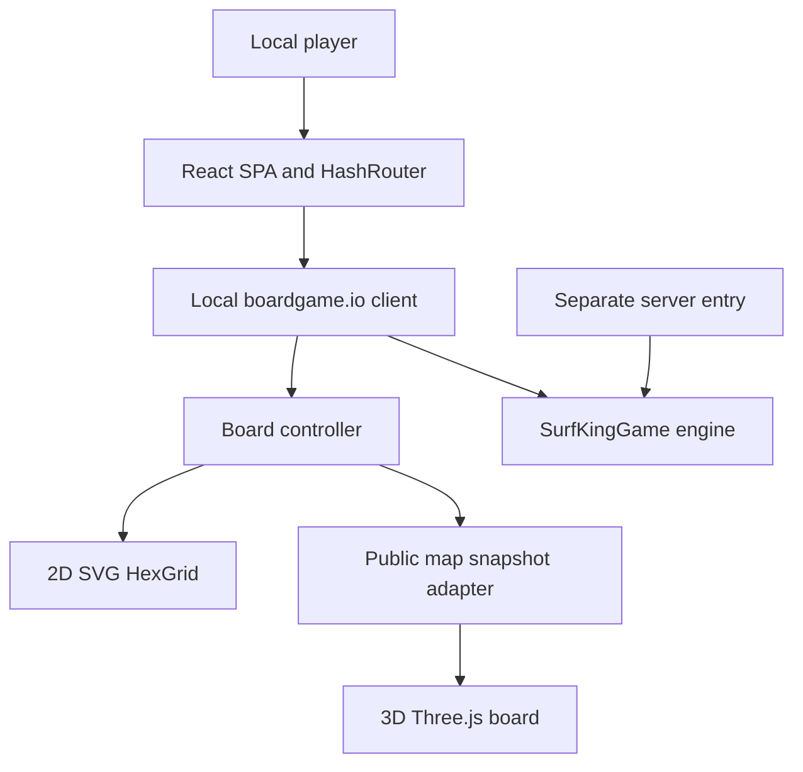
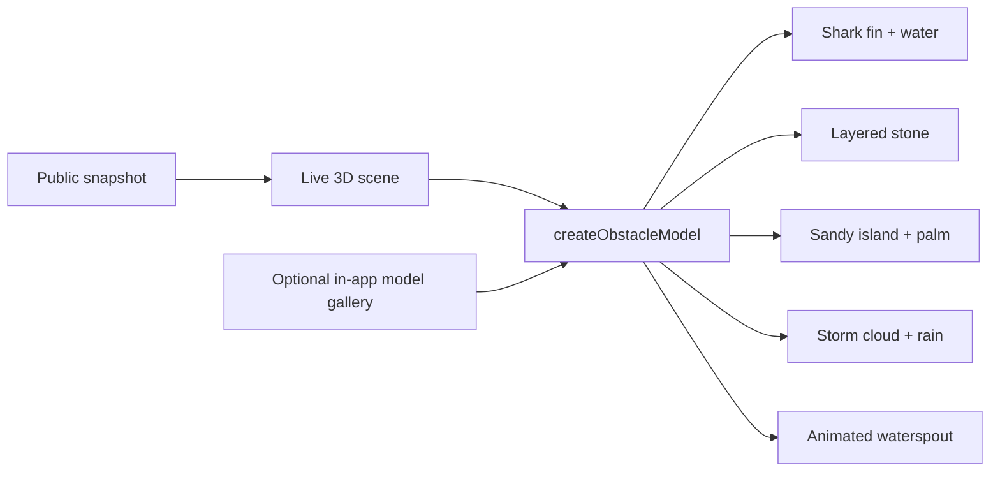
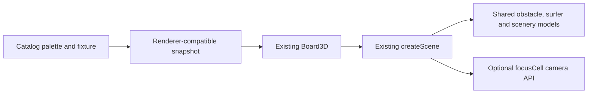
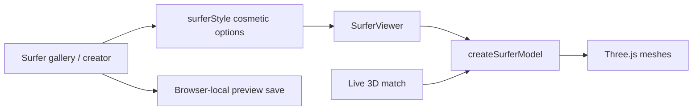

# Architecture

**Reference main baseline before PR #14:** `6daa1705` (2026-11-15). Deployment status is not established by merge state.

## Existing browser architecture (C4-style L2)

- The local game client and standalone server entry do not establish live online multiplayer.
- `src/components/Board/Board.js` owns UI actions, the selected 2D/3D view, and card handling.
- `src/map/contract/createPublicMapSnapshot.js` exposes cell/obstacle positions, players and turn metadata to rendering, not private card/deck data.
- Both 2D and 3D share `src/map/layout/board-layout.json` (53 cells); authoritative geometry remains provisional.
- `src/map/views/Board3D/createScene.js` controls camera, cell raycast, scene updates, animation, cleanup and live obstacle groups.
- Gameplay rules and scoring remain inside `src/game/SurfKingGame.js`, not Three.js.

## 3D obstacle model component (PR #14, L3)

- `obstacleModels.js` builds Three.js meshes for the five existing obstacle identifiers; `sharkModel.js` remains the dedicated dorsal-fin component.
- `createScene.js` instantiates the same factory from the authoritative public snapshot; no mock placements or image sprites are used in a match.
- The `/obstacles` route previews exactly these factories in a separate WebGL scene without modifying game state.
- Player models and coastal scenery continue using the existing `surfModels.js` and `createCoastalScenery.js` code.

## Interactive 3D board catalog (Issue #15, merged PR #16)

The standalone `/#/catalog` route uses the existing `Board3D` component rather than an independent renderer. A pure `catalogState.js` fixture creates 53 cells, model placements, surfer positions and a public snapshot matching the renderer contract. Its click tools operate only on local React state, not the real `boardgame.io` match.

This is a visual design sandbox with illustrative placements, not an alternate rules engine or authoritative gameplay state. PR #16 is merged into `main`; real browser validation is still pending. Merge does not establish deployment.

## Current obstacle visual refinement (Issue #13, in review)

`obstacleModels.js` keeps a single model factory for match, gallery and catalog. Stone and Island procedural meshes match the silhouettes/palette of the repository card images; Shark, Storm and Cyclone use foam/wakes directly above the scene ocean without opaque blue water cylinders. Storm flashes select among prebuilt branched lightning geometries; Cyclone and Shark use bounded deterministic multi-frequency motion. No per-frame meshes are allocated. All visual effects remain outside the game-state and rule engine.

## Surfer gallery and cosmetic creator (Issue #20, draft PR #21)

The existing `createSurferModel()` procedural Three.js model now accepts optional normalized cosmetic choices while preserving its original six-argument game rendering contract. The same constructor is used in live play and `SurferViewer`; no gameplay state enters the studio.

- `/#/surfers` selects four sample outfits and boards using a reusable WebGL preview.
- `/#/customize` adjusts presentation, hairstyle, hair/skin/surfwear colors, board silhouette and board color; changes rebuild actual geometry. `surferStyle.js` validates options.
- The preview uses shared scene primitives with OrbitControls. The UI contains CSS-drawn tropical scenery and an **approximation** of the approved wooden/crown logo rather than the exact screenshot asset.
- `Guardar visual` stores a versioned cosmetic object in the current browser's localStorage. **Selections are not associated with a player ID or match snapshot yet**, and have no gameplay effects.
- WebGL, mobile presentation, live-game style transfer and production build remain unverified.

## Limits and validation

- Static concept illustrations guided the visual direction but are **not exact exported 3D models**.
- No imported 3D assets or new external services are required.
- Full browser, WebGL, Jest and build validation remain pending; see [HANDOFF.md](HANDOFF.md).
- No changes to authoritative turn logic, 2D fallback, backend architecture or hosting.
