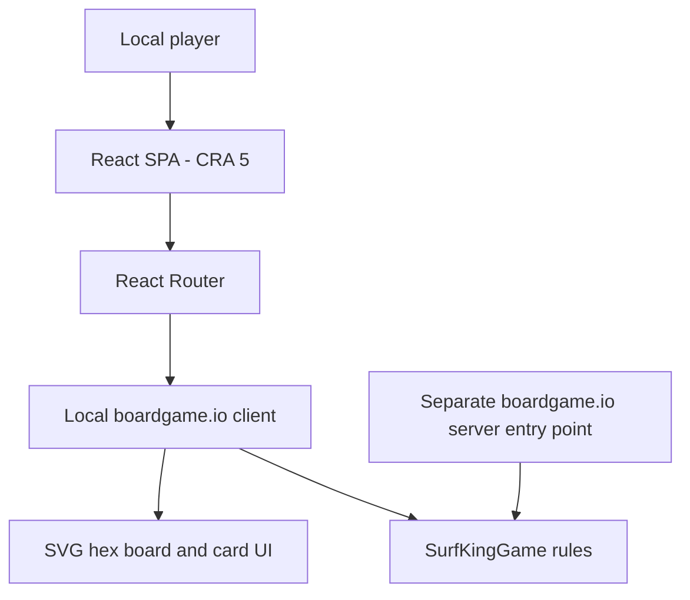
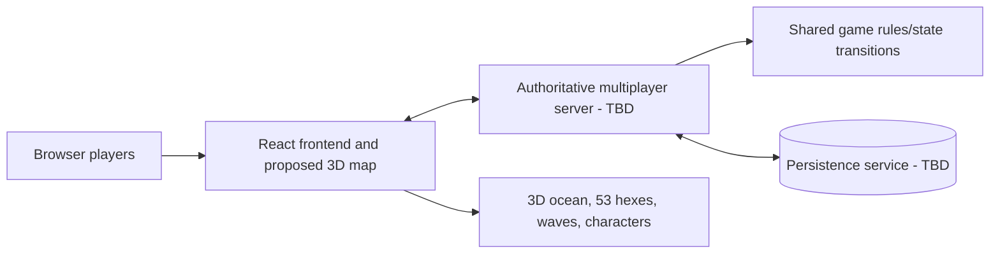

# Architecture

**Verified code baseline:** application code at `76f1a673219cbc8be28fd97dc76c1ecabf3394f3`; governance-only merge advanced `main` to `aff1274b687ead0b595007960962133b7a4ce31a` on 2026-11-14. This is not evidence of running production services.

## Existing structure (C4-style container view, L2)

The local client does not connect to the server in the inspected source. The home page contains links for online and AI play, but their routes in `src/Routes.js` are disabled.

## Existing components (L3 code boundaries)

| Component | Location | State |
| --- | --- | --- |
| Routing | `src/Routes.js` | Home/local routes enabled |
| Local client | `src/pages/LocalPage/index.js` | Instantiates `boardgame.io/react` client |
| Game rules | `src/game/SurfKingGame.js`, `Board.js`, `Cards.js` | State, move, card and turn logic implemented, untested in recovery |
| Board UI | `src/components/Board/`, `HexGrid/`, `Hex/` | SVG hexagons, clicks, card interactions |
| Server | `src/server/index.js` | Standalone `boardgame.io` server and lobby configuration |
| Tests | `src/game/__tests__/`, `src/App.test.js` | 21 files present; results unknown |

## Current contracts

- Game state (`G`) includes `cells`, `players`, `deck`, `discardedCards`, `turn` and `currentMove`.
- `boardgame.io` context (`ctx`) and moves include `maneuver`, `dropIn`, `useCard`, and `pass`.
- Logical positions are indices 0 through 52 (`GRID_SIZE = 53`). The grid UI currently creates 56 placeholder elements, and its cell mapping needs validation.
- The current rules engine is coupled to `boardgame.io` APIs.

## Target concept — proposed, not implemented (L2)

Options being investigated: Three.js/React Three Fiber, continued `boardgame.io` or Nakama, and Vercel/Render/Supabase. Selection and integration are not established by this diagram.

## Proposed interchangeable map views

Players should be able to switch between the existing 2D renderer and an independently developed 3D renderer without resetting the match or invoking game rules inside the view. See [MAP_RENDERING.md](MAP_RENDERING.md) for the proposed view-model interface, cell-ID mapping, mock preview, and asset integration requirements. This design is **not implemented**.

## Candidate cell mapping for 3D (Issue #7)

A provisional `src/map/layout/board-layout.json` manifest and pure lookup helpers map existing game indices 0–52 to world-space X/Z centers with 15 rows alternating four and three cells, sea to beach. They preserve the game's initial indices 0–6, the four shark positions 28–31 and the final winning indices 49–52. These are data-only integration scaffolding; **neither renderer is wired to the manifest yet**, and geometry is pending visual verification. No gameplay rule has been changed.

## Experimental game-connected 3D renderer (Issue #7, unmerged branch)

The candidate `src/map/contract/createPublicMapSnapshot.js` projects public data from `G` and `ctx` into a 53-cell snapshot without exposing decks or cards. The existing `Board.js` controller stays mounted while switching renderers, and both views forward cell picks to `onHexClickedHandle`. A standalone Three.js scene in `src/map/views/Board3D/` displays surfers and obstacles from live snapshots and provides orbit, pan, zoom and a fallback to the 2D grid. The renderer never calls `moves.*` directly. This feature remains unmerged and requires application/browser tests and canonical layout verification.

## Risks

- Dependency age, Node 16.17 Docker base, and `loadsh` versus `lodash` import discrepancy.
- Cell indexing and rendering contract not yet reconciled for the 3D scene.
- Authentication, persistence, server authority, reconnect behavior and deployment are unverified.

See [DECISIONS.md](DECISIONS.md) for approval status.
