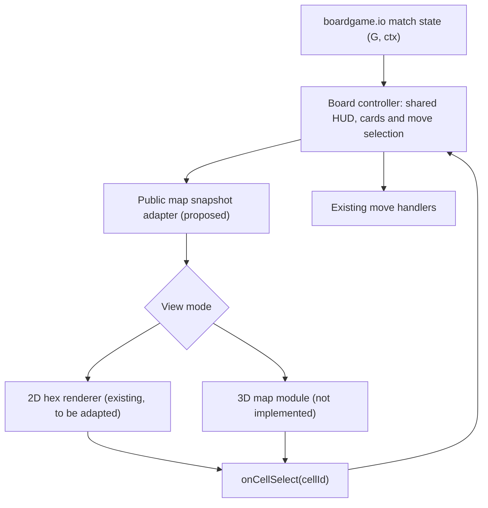

# Map Rendering Contract — Proposed Integration Design

**Status:** Design proposal for [Issue #5](https://github.com/board-games-jf/surf-king-react/issues/5); no 3D renderer or 2D/3D switch has been implemented. A selectable 2D/3D view of one match is approved in [DECISIONS.md](DECISIONS.md) (SK-DEC-008); the integration details remain proposed.

## Goal and ownership

The **game remains the only source of truth**. Rendering never decides moves, card effects, obstacle duration, turn order or victory. Switching between 2D and 3D must preserve the same `G` / `ctx` match instance, card selection workflow and current turn.



The current `src/components/Board/Board.js` combines `HexGrid`, interaction handling and the HUD. The smallest future refactor extracts its visual board only; game logic and card UI stay in the parent. View mode is **local UI state**, not a new match, player move or server action.

## Proposed renderer API

The following is an illustrative contract, **not an implemented TypeScript migration**:

```ts
type CellId = number; // Integer 0 through 52

type PublicMapCell = {
  id: CellId;
  obstacleType: string | null;
  remainingTurns: number | null;
};

type PublicMapPlayer = {
  id: string;
  cellId: CellId | null;
  avatarKey?: string;
};

type MapSnapshot = {
  cells: PublicMapCell[]; // Exactly 53 entries with unique IDs
  players: PublicMapPlayer[];
  turn: number;
  activePlayerId: string | null;
  selectedCellId: CellId | null;
};

type BoardViewProps = {
  snapshot: MapSnapshot;
  onCellSelect: (cellId: CellId) => void;
};
```

- The proposed adapter derives `snapshot` from the game state and controller selection; it must not include private hands, deck order, credentials, or authority-only data.
- Both renderers accept **the same** `snapshot` and emit only a **numeric cell ID**. The parent translates it to the existing handler (currently `onHexClickedHandle({ position: cellId })`), which is responsible for calling `moves.*`.
- Player positions, obstacles, visual selection and turn information flow **from** the engine **to** the maps. Visual effects such as waves must not mutate game state.
- Keep the HUD and card actions mounted across view changes. Load the 3D view lazily after the user chooses it; keep 2D available if 3D/WebGL is unavailable.

## Canonical cell layout — validation required

The engine uses `GRID_SIZE = 53` with indices **0–52** in `src/game/SurfKingGame.js`. The SVG component in `src/components/HexGrid/HexGrid.js` currently creates **56 placeholders** and computes IDs by a coordinate transform. This is **not** proof of a correct 53-cell layout.

Before integrating either view:

1. Establish a single, versioned **board layout manifest** with exactly 53 cells and unique stable `id` values (0–52), plus validated hex coordinates, neighboring cells and visual centers.
2. Check the manifest against the game rules, the established 2D layout and approved visual reference; do **not** infer cell IDs from GLB object order, mesh traversal or screen row order.
3. Add automated mapping tests: all IDs present once, no out-of-bounds IDs, symmetric physical adjacency, correct 2D/3D lookup and stable click-to-ID behavior.
4. Decide a 3D coordinate convention as part of that validation. **Proposed:** Y-up for glTF, world-space centers per cell, and a consistent hex size. No geometric dimensions are approved yet.
5. Keep the layout version independent from art revisions so that changing water, materials or surfer models cannot silently renumber cells.

## Provisional engine-to-world layout (Issue #7)

`src/map/layout/board-layout.json` contains a **candidate**, not yet Figma-verified, mapping from engine cell IDs 0–52 to 3D coordinates. `boardLayout.js` supplies lookups by ID and by row/column. Its 15 alternating rows run from sea (IDs 0–6 in rows 0–1) to beach (winning IDs 49–52 in row 14), with four initial shark cells 28–31 on row 8. The uploaded visual preview's separate display numbering and reversed Z orientation must not be used as game IDs. Review the mapping with the approved original board and existing 2D rendering before turning this into the final single source of truth. Engine move legality stays in `SurfKingGame.js`.

## Build the 3D map independently

The 3D artist/developer should be able to run an isolated preview without `boardgame.io`, auth, multiplayer or a backend. A **separate workspace/module inside this repository** is the lowest-maintenance default proposal; a second repository can be considered later if needed. No new repository or service is created by this Issue.

**Proposed module boundary (future code):**

```text
src/
  components/Board/             # Existing shared controller and HUD
  map/
    contract/                   # Public snapshot adapter and validated layout
    views/Board2D/              # Existing SVG renderer behind adapter
    views/Board3D/              # Independent 3D renderer entry point
    fixtures/                   # Synthetic board states for isolated preview
public/maps/surf-king/          # Versioned glTF/GLB models and textures
```

3D deliverable expectations:
- A reusable scene component implementing `BoardViewProps`, plus a preview that runs with synthetic `MapSnapshot` fixtures.
- Validated and versioned cell-center mapping against the canonical manifest. Cells can be pickable meshes generated from the manifest; artwork must not become the logical source of cell IDs.
- Ocean, waves, surfers and props supplied as appropriately licensed GLB/glTF assets and/or procedural visuals; assets themselves contain no gameplay rules.
- Camera defaults, focus/zoom, cell hover/selection states, responsive rendering and a documented fallback if 3D cannot load.
- An export/import guide that states engine/tool versions, units, orientation, model names, asset paths and ownership/licence information.

**An exported `.glb` alone does not implement gameplay clicks.** The integrator still needs the 3D scene adapter, consistent cell anchors and the `onCellSelect` callback. Conversely, a standalone interactive scene must not reimplement Surf King turns or attacks.

## Local gameplay candidate (Issue #7)

A follow-up branch proposes a direct Three.js scene adapter under `src/map/views/Board3D` and a public snapshot projection under `src/map/contract`. It reuses the user's ZIP coastal art direction, not its mock surfer or obstacle placements. The existing `Board` owns the renderer selector and all card/move callbacks; selecting 3D must never create a second match. The 53-cell layout is still provisional. Runtime/browser verification is outstanding; this does not represent an accepted renderer technology or a deployed feature.

## Planned implementation sequence (separate Issues)

1. Reproduce baseline tests and build; validate the 53-cell mapping and layout against authoritative references.
2. Extract a 2D renderer adapter **without changing existing gameplay behavior**; add tests for click routing and view-model privacy.
3. Add a view-mode selector and a safe, clearly marked unavailable/preview-only 3D state until the actual renderer exists. Ensure the same match and pending card-target selection survive switching.
4. Develop and test the 3D module with synthetic fixtures, then integrate it lazily; test map interactions, asset loading, frame rate and 2D fallback.

No runtime work, renderer library adoption, new hosting, merge, or deployment is authorized by this design document.
